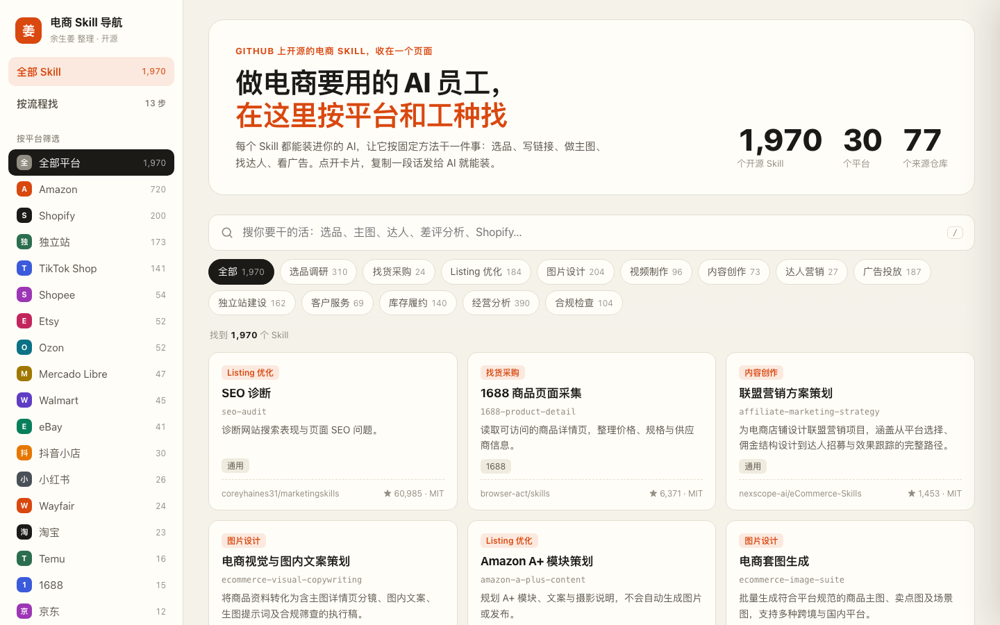

# jiang-ecom-skills · 电商 Skill 导航

做电商想让 AI 帮忙，但不知道有哪些现成的 Skill 能用？这里把 GitHub 上开源的电商 Skill 收到了一起，按平台和工种分好类，带一个本地网页，也能装进 AI 里直接问。



## 里面有什么

- **1,970 个开源电商 Skill**，来自 77 个 GitHub 仓库，每个都有中文名和一句话说明。
- **30 个平台**：亚马逊、Shopify、TikTok Shop、Shopee、Etsy、Ozon、沃尔玛、eBay、抖音小店、小红书、淘宝、Temu、1688、京东、拼多多等，还有不限平台的通用 Skill。
- **13 个工种**：选品调研、找货采购、Listing 优化、图片设计、视频制作、内容创作、达人营销、广告投放、独立站建设、客户服务、库存履约、经营分析、合规检查。
- **按流程找**：选一个平台，从选品到合规排成 13 步，每一步列出能用的 Skill。
- **一段话就能装**：点开任何一个 Skill，复制那段写好的话发给你的 AI，它会去把这个 Skill 装上。

Skill 是一份装进 AI 里的工作说明，装上之后 AI 会按固定的方法干一件具体的事。

## 怎么用

### 方式一：打开网页自己挑

下载这个仓库，双击 `assets/ecom-skills.html`，用浏览器打开就行。不用联网，不用账号。

左边选平台，上面选工种，中间搜你要干的活（比如“差评分析”“主图”“达人”）。点开卡片能看到中文说明、来源仓库、开源许可和安装用的那段话。

### 方式二：装进 AI 里直接问

你的 AI 得是装在电脑上、能自己安装 Skill 的那种。把下面这段话发给它：

```text
帮我安装 jiang-ecom-skills 这个 Skill，地址：https://github.com/aslanyushengjiang-coder/jiang-ecom-skills
把整个仓库下载到你的 Skill 目录，文件夹名保持 jiang-ecom-skills。装好后读一遍里面的 SKILL.md，然后告诉我“装好了”。
```

装好之后直接说：

> 我做亚马逊，有没有能分析竞品差评的 Skill？
>
> 我刚开始做 TikTok Shop，从选品到投放要装哪些 Skill？
>
> 打开电商 Skill 导航的网页。

会用命令行的也可以自己放：

```bash
git clone https://github.com/aslanyushengjiang-coder/jiang-ecom-skills.git ~/.claude/skills/jiang-ecom-skills
```

其他 AI 工具把文件夹放进它自己的 Skill 目录即可。查找脚本需要 Python 3.8 以上，不用装别的库：

```bash
python3 scripts/find.py --query "差评 分析" --platform Amazon
python3 scripts/find.py --flow "TikTok Shop"
python3 scripts/find.py --stats
```

## 要先知道的

- **只做收录和指路。** 每个 Skill 归原作者所有，许可以各自仓库的 LICENSE 为准。这里只放名称、说明、链接和许可信息，不复制 Skill 正文。
- **没有逐个安装测试。** 只核对了来源和开源许可，好不好用要自己装了试。
- **有的 Skill 要另外配数据接口、账号或付费服务**，点开卡片看原文，费用以原文为准。
- **中文名和说明大部分是 AI 标的**，按作者写的说明生成，可能有不准的地方，以原文为准。
- **没有覆盖全网。** 只收了有明确开源许可、能确认是电商用途的仓库；搜不到不代表没人做过。
- **来源不平均。** 亚马逊的 720 个里有 602 个来自同一个仓库。
- 目录更新于 2026-11-18。

## 来源和致谢

- 目录里 156 个 Skill 的中文名、说明、平台和分类，沿用了张滚滚公开的目录 [zarockfat/zgg-find-ecommerce-skills](https://github.com/zarockfat/zgg-find-ecommerce-skills)（MIT License）。想看更精挑细选、带费用和使用条件说明的版本，去看他的仓库。
- 其余条目由 AI 按作者说明标注。详见 [NOTICE.md](NOTICE.md)。
- 感谢每一位把自己的 Skill 开源出来的作者。发现哪条标错了、漏了哪个仓库，欢迎提 Issue。

## 许可

本仓库自己的代码、页面和目录整理部分用 [MIT License](LICENSE)。收录的各个 Skill 以其原仓库的许可为准。
